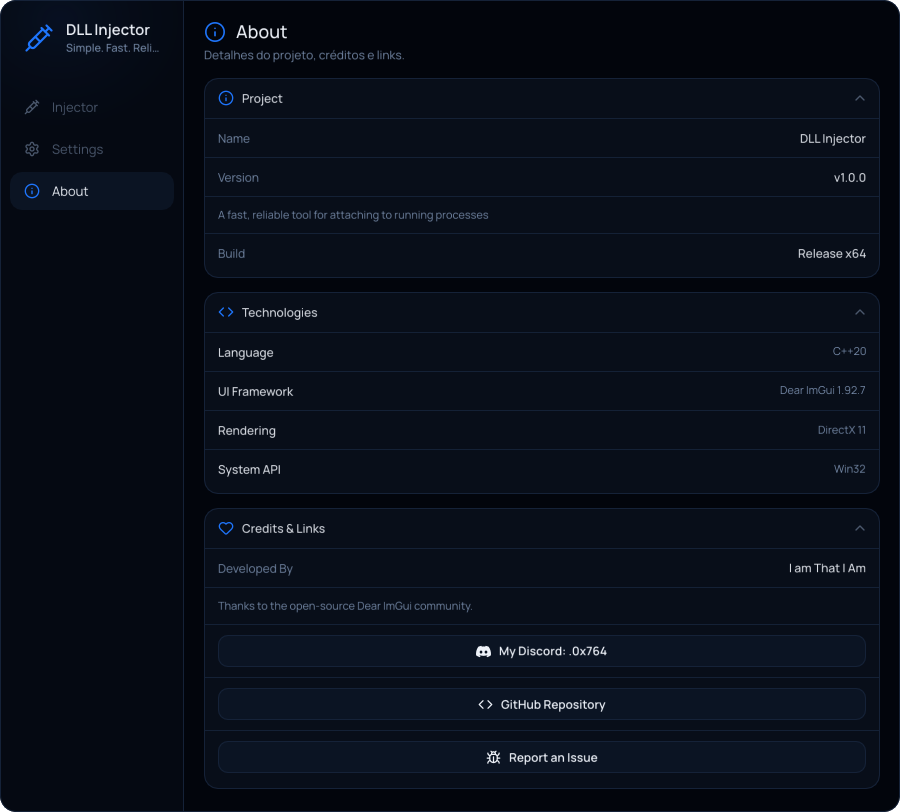

# DLL Injector



A Dear ImGui loader generated by Lazy UIs from the **Injector** frame of `DLL Injector (ImGui Builder)`. A borderless window sized to the frame, for launchers, login screens, and standalone tools.

## Build and run

You need Windows 10 or 11 and Visual Studio 2022 (or newer) with the **Desktop development with C++** workload.

1. Open `LazyUI.sln`.
2. Pick **Release** and **x64** in the toolbar.
3. Build with **Ctrl+Shift+B**, then run with **F5**. The app is `build/Release/LazyUI.exe`.

Or with CMake 3.20 or newer, from this folder:

```text
cmake -S . -B build
cmake --build build --config Release
```

## What's where

```text
LazyUI.sln            open this in Visual Studio
LazyUI.vcxproj
CMakeLists.txt        the same project for CMake
src/
  main.cpp            the window and the frame loop; your own start-up code goes here
  ui/                 the design, as code
    ui.hpp            ui::vars, every setting the UI shows, and render( )
    ui.cpp            the window: its background, navigation, and pages
    pages.cpp         every page: child sections and the widgets in them
    widgets.cpp       the design's own widgets: checkbox( ), slider( ), ...
    theme.hpp         the design's colors and size
    fonts.hpp/.cpp    the design's fonts and icons, and where its texts' letters go
    assets.hpp/.cpp   the design's pictures, embedded
  lazyui/             the LazyUI runtime the UI is written against
    lazyui.hpp        the app context (window, device, swap chain)
    window.hpp        the Win32 + DirectX 11 window
    runtime.hpp/.cpp  shapes, text, layout, widget state, motion, and shader backgrounds
    blur.hpp/.cpp     backdrop blur
    backdrop.hpp      frosted desktop under the window's own glass
    image.hpp/.cpp    pictures as GPU textures
vendor/imgui/         Dear ImGui
assets/               readable copies of the pictures, fonts, and icons the code embeds
build/                made by the first build (build/Release/LazyUI.exe)
```

## Read and change the settings

Application preferences are named fields in `ui::prefs` (`src/ui/ui.hpp`).
The remaining controls and the current process selection are stored in `ui::vars`.
Process names, PIDs and architecture come from Windows; log entries come from actual operations.

```cpp
#include "ui/ui.hpp"

ui::prefs.enable_animations = true;
ui::prefs.verbose_logging = true;
ui::vars.injection_delay = 150.f;
const unsigned int selected_pid = ui::vars.target_pid;
```

## Test tools

`test/injtest.c` is a test DLL that displays an `INJTEST-MARKER` window when executed.
It is not linked into the application and does not populate its process list or logs.
PowerShell test scripts resolve paths relative to their own directory.

Scripted UI input and frame capture are excluded from normal builds. To build a dedicated
test executable with these tools enabled, pass `/p:EnableTestHarness=true` to MSBuild,
or `-DINJECTOR_ENABLE_TEST_HARNESS=ON` to CMake. Test builds accept
`LAZYUI_CAPTURE` and `LAZYUI_CAPTURE_SCRIPT`; normal builds ignore these variables.

## Changing the design

The code in `src/ui` is yours to change. Converting the design again makes `src/ui` anew, so keep a copy of what you changed there, and keep your own code in `src/main.cpp` or files of your own.

## License

The design and the UI code generated from it (`src/ui`, `assets/`) are yours. The LazyUI runtime (`src/lazyui`) and the project template belong to Lazy UIs and are licensed to you for the apps you build from this project, including apps you sell; they may not be shared or sold on their own, or used to build another converter ([Terms of Service](https://lazyuis.com/terms#ownership)). Dear ImGui (`vendor/imgui`) is MIT-licensed: keep its notice when you distribute your app.

---

Made with [Lazy UIs](https://lazyuis.com). Contact: merkurydev on Telegram and Discord.
