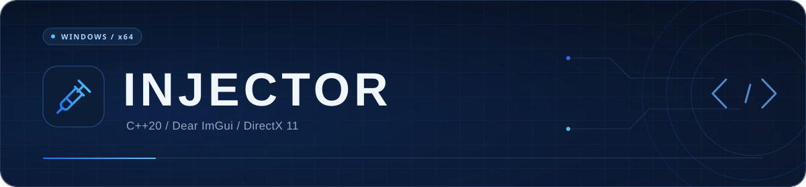

<p align="center">
  
</p>

<p align="center">
  Injetor de DLLs para Windows x64, escrito em C++20 com Dear ImGui e DirectX 11.
</p>

<p align="center">
  <a href="#compilar"></a>
  <a href="CMakeLists.txt"></a>
  <a href="vendor/imgui"></a>
  <a href="CMakeLists.txt"></a>
  <a href="Injector.sln"></a>
  <a href="CMakeLists.txt"></a>
</p>

<p align="center">
  <a href="#recursos">Recursos</a> &nbsp;·&nbsp;
  <a href="#interface">Interface</a> &nbsp;·&nbsp;
  <a href="#tecnologias">Tecnologias</a> &nbsp;·&nbsp;
  <a href="#compilar">Compilar</a> &nbsp;·&nbsp;
  <a href="#estrutura">Estrutura</a> &nbsp;·&nbsp;
  <a href="#contato">Contato</a>
</p>

---

<a id="recursos"></a>

## Recursos

- LoadLibrary, Manual Map e Thread Hijack.
- Lista de processos com nome, PID, arquitetura, pesquisa e atualização manual.
- Logs com horário, cores por severidade, quebra de linha e rolagem.
- Delay e nova tentativa automática configuráveis.
- Opacidade, cores e animações ajustáveis.
- Notificações, sons opcionais e gravação de logs em arquivo.

<a id="interface"></a>

## Interface

<p align="center">
  
</p>

<a id="tecnologias"></a>

## Tecnologias

| Tecnologia | Uso |
| :--- | :--- |
| **C++20** | Linguagem. |
| **Dear ImGui 1.92.7** | Interface. |
| **DirectX 11 / DXGI** | Renderização. |
| **Win32 API** | Janela, diálogos e consulta de processos. |
| **DWM / Windows Imaging Component** | Composição da janela e imagens. |
| **Visual Studio / MSVC** | IDE e compilador. |
| **CMake** | Configuração da compilação. |

Dear ImGui está incluído em [`vendor/imgui`](vendor/imgui). Fontes, ícones e imagens ficam em [`assets`](assets) e são embutidos no executável.

<a id="compilar"></a>

## Compilação

### Requisitos

- **Windows 10 ou 11**.
- **Visual Studio 2022 ou mais recente**, com a carga de trabalho **Desenvolvimento para desktop com C++** e o Windows SDK.
- **CMake 3.20+** para compilar pelo CMake.

### Clonar

```bash
git clone https://github.com/er1ck-xyz/Injector.git
cd Injector
```

<details open>
<summary><strong>Visual Studio Community</strong></summary>

1. Abra [`Injector.sln`](Injector.sln).
2. Selecione **Release** e **x64** na barra de ferramentas.
3. Compile com **Ctrl + Shift + B**.
4. Execute com **F5** ou abra o arquivo gerado:

```text
build/Release/Injector.exe
```

</details>

<details>
<summary><strong>CMake</strong></summary>

Na pasta do projeto:

```powershell
cmake -S . -B build/cmake -G "Visual Studio 17 2022" -A x64
cmake --build build/cmake --config Release
```

Executável:

```text
build/cmake/Release/Injector.exe
```

Para outra versão do Visual Studio, ajuste o gerador em `-G`.

</details>

## Uso

1. Selecione um processo x64 na lista.
2. Clique em **Browse** e selecione uma DLL x64.
3. Configure o método e o delay em **Settings**.
4. Clique em **Inject** e acompanhe o resultado em **Injection Log**.

<a id="estrutura"></a>

## Estrutura

```text
Injector/
├── Injector.sln          # Solução do Visual Studio
├── Injector.vcxproj      # Configuração do projeto C++
├── CMakeLists.txt        # Configuração do CMake
├── src/
│   ├── main.cpp          # Inicialização e loop da aplicação
│   ├── process.*         # Enumeração e consulta dos processos
│   ├── inject.*          # Métodos de carregamento, estado e logs
│   ├── ui/               # Páginas, widgets, tema e recursos embutidos
│   └── injector/         # Janela, renderização e efeitos visuais
├── assets/               # Fontes, ícones e imagens
├── vendor/imgui/         # Dear ImGui e backends utilizados
├── tests/injtest.dll     # DLL x64 para validação local
└── preview.png           # Captura da interface
```

<details>
<summary><strong>Personalização</strong></summary>

| Arquivo | O que editar |
| :--- | :--- |
| [`src/ui/pages.cpp`](src/ui/pages.cpp) | Conteúdo e layout das páginas. |
| [`src/ui/widgets.cpp`](src/ui/widgets.cpp) | Aparência e comportamento dos controles. |
| [`src/ui/theme.hpp`](src/ui/theme.hpp) | Cores e constantes visuais. |
| [`src/ui/ui.hpp`](src/ui/ui.hpp) | Preferências em `ui::prefs` e estado em `ui::vars`. |

```cpp
#include "ui/ui.hpp"

ui::prefs.enable_animations = true;
ui::prefs.verbose_logging = true;
ui::vars.window_opacity = 100.f;
ui::vars.injection_delay = 150.f;
```

</details>

<a id="testes"></a>

## DLL de teste

[`tests/injtest.dll`](tests/injtest.dll) é uma DLL x64 que exibe a janela `INJTEST-MARKER` quando executada. Não é necessária para compilar o projeto.

<details>
<summary><strong>Ferramentas de teste</strong></summary>

Captura de frames e entrada por script são desativadas por padrão. Para habilitar:

**MSBuild** — execute no Developer PowerShell do Visual Studio:

```powershell
msbuild Injector.sln /p:Configuration=Release /p:Platform=x64 /p:EnableTestHarness=true
```

**CMake:**

```powershell
cmake -S . -B build/cmake-tests -G "Visual Studio 17 2022" -A x64 -DINJECTOR_ENABLE_TEST_HARNESS=ON
cmake --build build/cmake-tests --config Release
```

Essas compilações aceitam `INJECTOR_CAPTURE` e `INJECTOR_CAPTURE_SCRIPT`.

</details>

<a id="contato"></a>

## Contato

[Issues](https://github.com/er1ck-xyz/Injector/issues) · Discord: **`.0x764`**

Ao reportar um erro, inclua os passos para reproduzir e a mensagem do log.

<p align="center">
  <a href="https://github.com/er1ck-xyz/Injector"></a>
  <a href="https://github.com/er1ck-xyz/Injector/issues"></a>
  
</p>

---

<p align="center">
  <sub>Desenvolvido por <strong>I am That I Am</strong> · <a href="#recursos">Voltar ao início ↑</a></sub>
</p>
